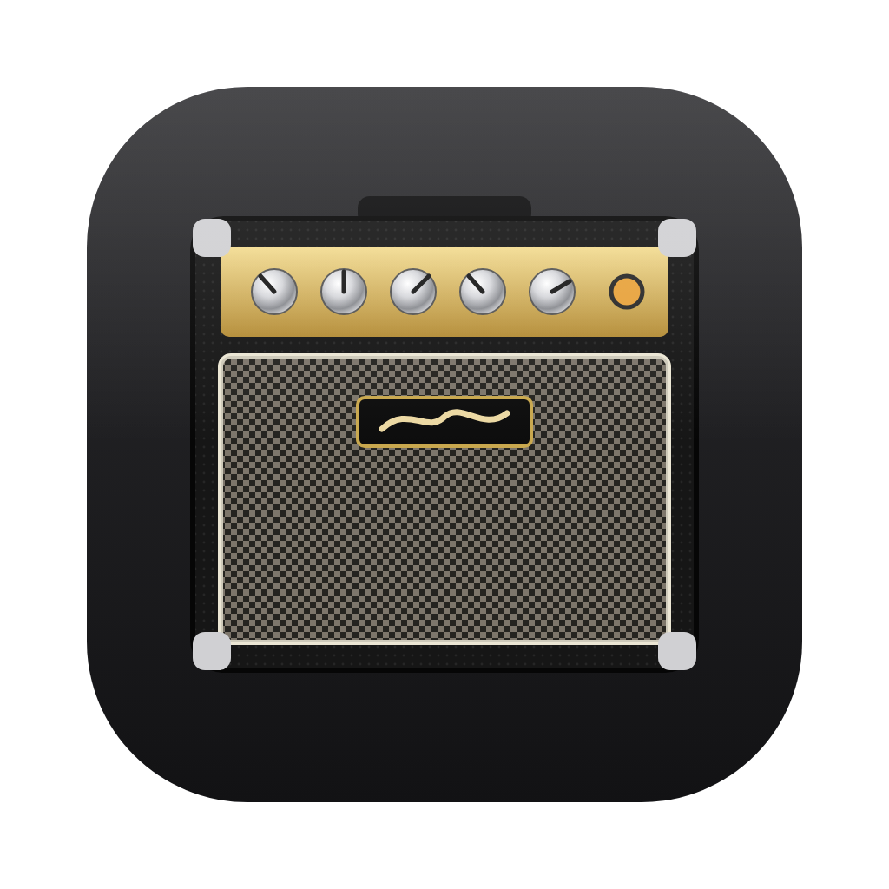

# Rigsmith

A guitar rig simulator for macOS. Place as many pedals, amps, cabs, mics, splitters and power supplies as you like, cable them in any order, and your guitar plays through it live, the way it would through the real thing.



## What it does

- **Free routing.** Audio follows the cables, like a real rig. Amps have an effects loop (send/return), and splitters and joiners let you run parallel chains, for example two amps panned left and right.
- **Power matters.** A pedal with no power cable is silent. Press P, or click "Plug into power", to wire it to a free outlet.
- **Two views.**
  - **Board:** the stage, the pedalboard and the desk, drawn like real gear.
  - **Grid:** Quad Cortex-style tiles in signal order, with a panel that shows the whole rig or the selected block.
- **Gear:** 9 amps, 4 cabs, 3 mics and 30 pedals (dynamics, drive, fuzz, pitch, filter, modulation, delay, reverb, looper), each with its own fictional maker and look.
- **Presets:** 30 built-in presets (clean, acoustic, crunch, lead, metal, ambient, two-amp stereo), plus your own.
- **Tools:**
  - a standalone tuner
  - master and input mute
  - input and output meters
  - latency, CPU and RAM readouts
  - undo and redo
  - keyboard shortcuts
- **Files:** rigs export as encrypted `.rigsmith` files.

## Requirements

- macOS on Apple silicon or Intel, with the Xcode Command Line Tools (`xcode-select --install`).
- CMake 3.22 or newer.
- Node.js 22 or newer.
- An audio interface for your guitar, plus wired headphones or monitors. Bluetooth adds too much latency to play through.

## Build and run

```sh
npm install
npm run build                       # UI → dist/
cmake -S native -B native/build -DCMAKE_BUILD_TYPE=Release   # first time only; fetches JUCE 8
cmake --build native/build -j8      # builds the app and copies dist/ into it
open native/build/Rig_artefacts/Release/Rigsmith.app
```

On first launch, open **Audio settings** (the sliders icon, top right). Choose your interface, enable its guitar input, and set a buffer size of 64 or 128 samples. Then pick the input on the **DI box** and set its trim so the input meter peaks just below the clip light.

### Developing the UI

```sh
npm run dev -- --port 5173
RIG_DEV_URL=http://localhost:5173 open native/build/Rig_artefacts/Release/Rigsmith.app
```

With `RIG_DEV_URL` set, the app loads the Vite dev server, so UI changes hot-reload.

## Using it

- **Add gear:** click an item in the gear list on the left. You can also drag it onto the rig, or drop it onto a cable to put it in that cable.
- **Cable:** drag from one jack to another. A refused connection tells you why, for example "That would make a feedback loop".
- **Edit:**
  - Drag a knob up or down; double-click it to reset.
  - Click a pedal's footswitch to turn it on or off.
  - Double-click any device for a large view with every control, plus **Replace** and **Delete**.
- **Mics:** drag a mic onto a cab, then drag it across the cone. The centre is brighter and the edge darker. Scroll over the mic to move it closer or farther.
- **Shortcuts:** press **?** for the full list. The main ones:

| Key | Action |
|---|---|
| ← → | Previous / next preset |
| V | Board / Grid |
| T | Tuner |
| M / I | Mute output / mute guitar input |
| 1–9 | Stomp pedal 1–9 in signal order |
| B / P / Enter | Bypass, power, open the selected device |
| ⌫ | Delete the selected device or cable |
| \ | Show or hide the gear list |
| ⌘Z / ⇧⌘Z | Undo / redo |
| ⌘S / ⌘O / ⌘E | Save preset / open / export `.rigsmith` |

Your rig autosaves. Named presets and the autosave live in `~/Library/Application Support/Rig/Rigs`.

## Rig files

Export (⌘E) writes a `.rigsmith` file:
- **Encryption:** AES-256-CBC with an HMAC-SHA256 tag (`native/RigFile.h`).
- **Tampering:** a file that was changed or damaged outside the app is refused.
- **Older rigs:** `.json` files still import.
- **Limits:** the key is built into the app. That keeps rigs from being read or edited by other tools, but it is not protection against someone who takes the app apart.

## Checks and tools

```sh
npm test                                      # routing rules, presets, layout, replace/insert (vitest)
native/build/RigCheck_artefacts/Release/RigCheck   # audio engine checks: every device, every amp/cab, tuner, rig files
npm run render                                # every preset → renders/*.wav, with its tone balance
npm run render -- my-di.wav                   # your own dry guitar recording through every preset
npm run render -- Metal                       # only presets matching a name or category
```

`npm run render` needs the native build, since it drives `RigRender`. Without a DI file it plays a synthesised guitar: chords for clean, crunch and acoustic, a lead phrase for leads, and palm-muted chugs for metal.

## How it's built

- **UI:** React 19 and TypeScript, with React Flow, running in JUCE's web view.
  - `src/rig.ts` is the rig model: devices, cables, routing rules, undo, and `compile()`.
  - `src/layout.ts` places gear on the board and the grid.
  - `src/gear.tsx` draws the gear.
- **Engine:** C++ with JUCE 8.
  - `native/Engine.h` runs the compiled rig as a node graph. It builds each new graph off the audio thread and fades between graphs, so re-cabling never clicks.
  - `native/Devices.h` holds one sound model per device. Amps have oversampled gain stages, a tone stack and a power section with sag. Cabs and the acoustic body are generated impulse responses.

`PLAN.md` has the full design: decisions, routing rules, data model, device catalog and what's planned next.

## Notes

- **Names:** all brand names on the gear are fictional. Models are described by what they're inspired by ("UK Plexi", "US Rectified"), never by a real product name.
- **Tuning:** the tone was tuned by measurement. A real DI recording is the best way to judge and retune it (see `npm run render -- my-di.wav`).
- **Platform:** macOS only for now. The file encryption uses CommonCrypto.
